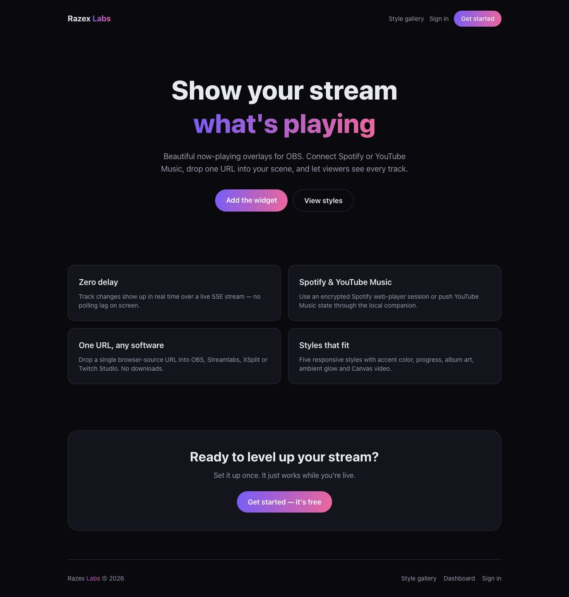
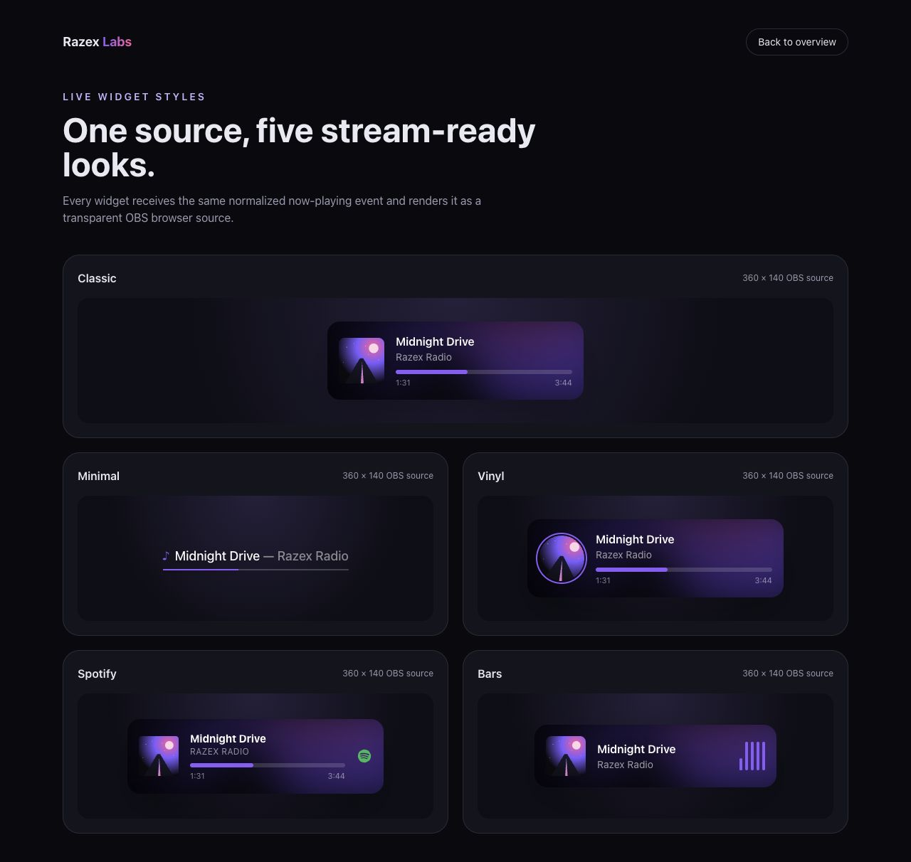

# Razex Now Playing

[](https://github.com/RAZEX0LOL/razex-now-playing/actions/workflows/ci.yml)
[](LICENSE)

A self-hosted, real-time now-playing widget for OBS and other streaming software. It turns Spotify or YouTube Music state into a customizable browser-source overlay with five visual styles.



## Why this project

The interesting part is not the card UI. It is the end-to-end delivery path: secure source credentials, normalized playback events, subscriber-aware polling, Server-Sent Events, transparent browser-source rendering, and a deployment setup that keeps latency low.

## Engineering highlights

- Real-time updates over Server-Sent Events with keep-alives and nginx buffering disabled.
- Subscriber-aware Spotify polling: the server polls only while an overlay is open.
- Spotify and YouTube Music normalized into one typed `NowPlaying` contract.
- Five customizable styles: Classic, Minimal, Vinyl, Spotify, and Bars.
- Multiple widget profiles, each with its own bearer URL and appearance settings.
- AES-256-GCM encryption at rest for the Spotify web-player session cookie.
- Timing-safe dashboard password comparison and authenticated settings APIs.
- Validated ingest payloads, HTTPS-only remote artwork, bounded strings, and clamped durations.
- PostgreSQL persistence through Prisma, reproducible Bun lockfile, Docker, and CI.
- Dependency-free Bun unit tests for secret storage, source normalization, and input validation.

## Style gallery



## Architecture

```text
Spotify web session ── subscriber-aware poller ─┐
                                                ├─ normalized NowPlaying event
YouTube Music ── local companion ── ingest API ─┘
                         │
                         ▼
                in-memory channel store
                         │
                         ▼ Server-Sent Events
                public widget bearer URL
                         │
                         ▼
                 OBS Browser Source

Dashboard / Auth.js ── Prisma ── PostgreSQL
       │
       └─ encrypted source credential + widget settings
```

The in-memory event store is deliberate for a single-instance self-hosted deployment. A horizontally scaled version should replace it with Redis pub/sub.

## Stack

- Next.js App Router, React, and TypeScript
- Tailwind CSS and Framer Motion
- Auth.js credentials provider
- Prisma and PostgreSQL
- Bun for installs, scripts, and tests
- Docker Compose and nginx

## Quick start

Requirements: Bun 1.4+, Docker with Compose, and a modern Node-compatible runtime.

1. Create local configuration:

   ```bash
   cp .env.example .env
   chmod 600 .env
   ```

2. Replace every placeholder. Generate independent secrets:

   ```bash
   openssl rand -base64 32 # AUTH_SECRET
   openssl rand -base64 32 # CREDENTIALS_ENCRYPTION_KEY
   ```

3. Start PostgreSQL and initialize the schema:

   ```bash
   docker compose up -d db
   bun install --frozen-lockfile
   bun run db:push
   ```

4. Start the application:

   ```bash
   bun run dev
   ```

Open `http://localhost:3000`. The style gallery at `/demo` does not require a database or credentials.

## Source setup

### Spotify

The owner pastes the `sp_dc` value from an authenticated Spotify web-player session into the protected dashboard. The application verifies it, encrypts it with AES-256-GCM, and stores only the encrypted payload. Short-lived access tokens remain in memory.

This integration uses unofficial Spotify web-player and Canvas endpoints because the project is designed for personal self-hosting. Those endpoints can change without notice. Never use a Spotify cookie from an account you do not control.

### YouTube Music

The companion supports the `th-ch/youtube-music` Companion Server handshake and a generic JSON source:

```bash
NOWAVE_URL=https://now-playing.example.com \
INGEST_KEY=copy-from-the-dashboard \
YTM_URL=http://127.0.0.1:9863 \
node scripts/ytmusic-companion.mjs
```

The companion stores its local pairing token with mode `0600`. The server validates and bounds every ingest field before publishing it.

## Production deployment

```bash
docker compose up -d --build
```

The app binds to `127.0.0.1` by default. Put the example [`deploy/nginx.conf`](deploy/nginx.conf) behind valid TLS certificates. Back up PostgreSQL before upgrades; `db push` is intentionally configured to stop rather than accept destructive schema changes.

For a larger deployment, add rate limiting at the reverse proxy, centralized logs, health monitoring, automated backups, and Redis-backed pub/sub.

## Verification

```bash
bun install --frozen-lockfile --ignore-scripts
bun run check
```

The check runs ESLint with zero warnings, strict TypeScript validation, Bun unit tests, Prisma generation, and a production Next.js build.

## Security

Widget URLs and YouTube Music ingest keys are bearer credentials. Do not publish them in screenshots, logs, issues, or documentation. Secrets belong only in the untracked `.env` file or a secret manager.

See [SECURITY.md](SECURITY.md) for reporting and deployment guidance.

## License

[MIT](LICENSE) © 2026 Rasul Khattaev.

This project is not affiliated with Spotify, YouTube, Google, OBS, or their respective owners. Product names and logos remain the property of their owners.
